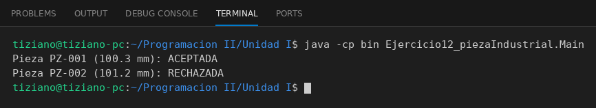

# PiezaIndustrial

Programación II - Unidad 1 - Ejercicio 12

## Consigna
Registrar las mediciones de una pieza metálica y verificar si cumple la tolerancia respecto del estándar.

## Lógica
- **Atributos (privados):** `codigoPieza` (String), `longitudMilimetros` y `longitudEstandar` (double).
- **Constructor:** valida que ambas longitudes sean positivas (`IllegalArgumentException` si no).
- **`esAceptable()`:** retorna `true` si `Math.abs(longitudMilimetros - longitudEstandar) <= 0.5`; el valor absoluto hace que cuente igual estar 0.3 mm de más que de menos.
- **`Main`:** dos piezas contra un estándar de 100 mm: 100.3 mm (aceptada) y 101.2 mm (rechazada); imprime el dictamen de cada una.

## Ejecución

